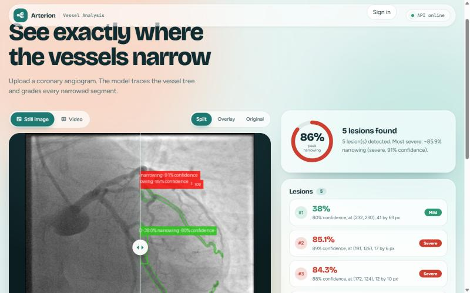

# Arterion Vessel Analysis

[](https://github.com/kartikpagariya25/arterion-vessel-analysis/actions/workflows/test.yml)  

Coronary angiogram analysis in the browser: segments the vessel tree, finds narrowed segments (stenosis), estimates how narrow each one is, and writes a clinician report plus a plain-language patient report in English, Hindi and Marathi.



> **Research prototype — not a medical device.** Outputs are AI-assisted screening aids and must be reviewed by a qualified cardiologist.

Part of the [Arterion](https://github.com/kartikpagariya25/Arterion) project.

## How it works

1. **Vessel segmentation** — U-Net (ResNet-34 encoder) trained on the 25 vessel-segment classes of ARCADE.
2. **Stenosis detection** — a second U-Net trained on the ARCADE stenosis masks; connected regions become lesions.
3. **Severity** — the vessel mask is skeletonised and the local width at each lesion is compared with the neighbouring healthy width: `narrowing % = 1 − lesion width / reference width`, bucketed into mild (<50%), moderate (50–70%) and severe (>70%).
4. **Report** — rule-based by default; set `GEMINI_API_KEY` for an LLM-written multilingual report.

Videos are scanned every N frames and the most affected frame is returned.

## Results (ARCADE held-out test split, 300 images)

| Task | Dice | IoU | Precision | Recall |
|---|---|---|---|---|
| Vessel segmentation | 0.774 | 0.644 | 0.832 | 0.743 |
| Stenosis segmentation | 0.594 | 0.450 | 0.618 | 0.658 |

Severity estimation was verified on a synthetic constriction with a known answer (predicted 70.0 %, expected 70 %). It has **not** been validated against clinical quantitative coronary angiography.

The stenosis model was initialised from the trained vessel model and fine-tuned (v1.1.0 weights; v1.0.0 had Dice 0.575). It still falls just short of the project's 0.60 target.

## Run it

```bash
# 1. get the trained weights (GitHub Release)
./scripts/fetch_weights.sh          # or: .\scripts\fetch_weights.ps1

# 2. start everything
docker compose up --build
# frontend: http://localhost:8080   API docs: http://localhost:8000/docs
```

Without Docker:

```bash
cd backend && pip install -r requirements-dev.txt
uvicorn app.main:app --port 8000          # API
cd ../frontend && python -m http.server 8080
```

The frontend talks to `window.API_BASE` (`frontend/js/config.js`, default `http://localhost:8000`).

### API

| Endpoint | Body | Returns |
|---|---|---|
| `POST /uploads` | multipart `file` | `{file_url}` |
| `POST /vessel-analysis/predict` | `{file_url}` (image) | overlay, lesions, summary |
| `POST /vessel-analysis/report` | `{file_url}` (image) | the above + `report` |
| `POST /vessel-analysis/predict-video` | `{file_url, frame_stride}` | key frame, lesions, `report` |

Wrong media types return HTTP 422 with a readable `detail`; empty uploads 400; files over 200 MB 413. If weights are missing the API answers with a "weights not found" summary and the UI explains how to install them.

Tests: `cd backend && pytest tests`.

## Training

`training/` holds the full pipeline (data download, COCO loader, U-Net, Dice + focal-Tversky loss, training, evaluation, ONNX export, severity analysis). See `training/IMPLEMENTATION.md`.

## Data and licences

Code: MIT. Trained on [ARCADE](https://zenodo.org/records/8386059) (Popov et al., 2024) — see the dataset page for its terms.
