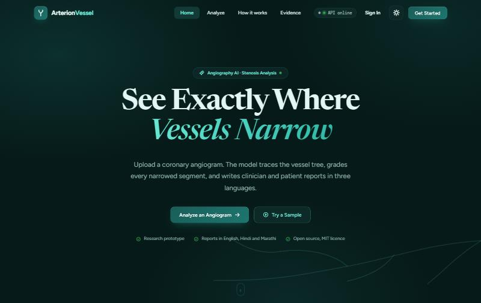

# Arterion Vessel Analysis

[](https://github.com/kartikpagariya25/arterion-vessel-analysis/actions/workflows/test.yml)  

Coronary angiogram analysis in the browser: segments the vessel tree, finds narrowed segments (stenosis), estimates how narrow each one is, and writes a clinician report plus a plain-language patient report in English, Hindi and Marathi.


> **Research prototype — not a medical device.** Outputs are AI-assisted screening aids and must be reviewed by a qualified cardiologist.

Part of the [Arterion](https://github.com/kartikpagariya25/Arterion) project.

## How it works

1. **Vessel segmentation** — U-Net (ResNet-34 encoder) trained on the 25 vessel-segment classes of ARCADE.
2. **Stenosis detection** — a second U-Net trained on the ARCADE stenosis masks; connected regions become lesions.
3. **Severity** — the vessel mask is skeletonised and the local width at each lesion is compared with the neighbouring healthy width: `narrowing % = 1 − lesion width / reference width`, bucketed into mild (<50%), moderate (50–70%) and severe (>70%).
4. **Report** — rule-based by default; set `GEMINI_API_KEY` for an LLM-written multilingual report.

Videos are scanned every N frames and the most affected frame is returned.

## Results (ARCADE held-out test split, 300 images)

| Task | Dice | IoU | Precision | Recall |
|---|---|---|---|---|
| Vessel segmentation | 0.774 | 0.644 | 0.832 | 0.743 |
| Stenosis segmentation | 0.594 | 0.450 | 0.618 | 0.658 |

Severity estimation was verified on a synthetic constriction with a known answer (predicted 70.0 %, expected 70 %). It has **not** been validated against clinical quantitative coronary angiography.

The stenosis model was initialised from the trained vessel model and fine-tuned (v1.1.0 weights; v1.0.0 had Dice 0.575). It still falls just short of the project's 0.60 target.

## Accounts, history and the doctor dashboard

Sign in from the top of the site to keep a history of your angiogram scans. Without an account everything still works; results just are not saved.

- **Patients** register with an email and password. Every analysis they run while signed in is saved (the findings, not images or long signals) and listed on `history.html`, together with any note a doctor adds. They can delete single analyses, change their password or delete their account and all of its data.
- **Doctors** get a dashboard on the same page: *Awaiting review*, *All analyses* (filter by type, status or patient), *Patients* and *My analyses*. They open any analysis and write a review note that the patient sees.
- **Doctor sign-up needs an invite code.** Set `DOCTOR_INVITE_CODE` on the backend; with it unset, doctor registration is disabled. To create the first doctor (or reset a forgotten password; there is no email reset):

```bash
cd backend
python -m app.accounts.cli create-user --email doc@example.com --name "Dr Doc" --role doctor
python -m app.accounts.cli set-password --email someone@example.com
```

Under the hood: SQLite, passwords hashed with scrypt, HS256 JWTs, and a lockout after five failed logins per email (15 minutes). See [SECURITY.md](SECURITY.md) for what this does and does not protect.

| Setting | Default | Meaning |
|---|---|---|
| `DATA_DIR` | `backend/data` (a Docker volume in compose) | where `arterion.db` and the generated JWT secret live |
| `JWT_SECRET` | generated once, kept in `DATA_DIR` | signing key; set it to share tokens between replicas |
| `JWT_EXPIRE_MINUTES` | `480` | token lifetime |
| `DOCTOR_INVITE_CODE` | empty (doctor sign-up off) | code required to register as a doctor |
| `REQUIRE_AUTH` | off | `1` makes every endpoint, uploads included, require a signed-in user |

| Endpoint | Who | Purpose |
|---|---|---|
| `POST /auth/register`, `POST /auth/login` | anyone | create an account / get a token |
| `GET /auth/me`, `POST /auth/password`, `DELETE /auth/me` | signed in | profile, change password, delete account and data |
| `GET /history`, `GET /history/{id}`, `DELETE /history/{id}` | signed in | the caller's own saved analyses |
| `GET /history/export.csv` | signed in | the caller's saved analyses as a CSV file |
| `GET /history/series?task=` | signed in | the headline value (peak stenosis (images and angiogram videos)) of each saved analysis for that task, oldest first, for charting |
| `GET /doctor/analyses/export.csv` | doctor | all analyses as CSV; filter with `patient_id`, `task`, `reviewed` |
| `GET /doctor/patients/{id}/series?task=` | doctor | the same series for one patient |
| `GET /health`, `GET /ready` | anyone | liveness, and readiness (database and upload directory) |
| `GET /doctor/patients`, `GET /doctor/analyses[/{id}]` | doctor | all patients and their analyses |
| `POST /doctor/analyses/{id}/review` | doctor | add or update a review note |

Prediction endpoints take an optional `Authorization: Bearer <token>`; when present the result is saved and the response carries an `X-History-Id` header.

## Design

The site follows one landing-page system: a floating navigation (logo mark, centre pills, sign-in, Get Started), a hero with a serif headline and an italic gradient second line, six feature cards, a four-step process, the working tool, a dark evidence section with the real held-out metrics, a call to action and a footer.

- **Palette:** teal and white. Tokens live in `frontend/css/theme.css`.
- **Type:** Newsreader for headlines, Figtree for text, DM Mono for numbers.
- **Motion:** GSAP ScrollTrigger drives scroll progress, reveals, the rail that connects the steps and the metric bars. Motion (the vanilla build of the Framer Motion engine) drives the hero entrance, button springs and count-ups. Everything collapses to a static page under `prefers-reduced-motion`.
- **Themes:** light and dark. The toggle in the navigation follows your system until you choose, and remembers the choice. Tokens for both live in `frontend/css/theme.css`.
- **Details:** see [DESIGN.md](DESIGN.md).



## Run it

```bash
# 1. get the trained weights (GitHub Release)
./scripts/fetch_weights.sh          # or: .\scripts\fetch_weights.ps1

# 2. start everything
docker compose up --build
# frontend: http://localhost:8080   API docs: http://localhost:8000/docs
```

Without Docker:

```bash
cd backend && pip install -r requirements-dev.txt
uvicorn app.main:app --port 8000          # API
cd ../frontend && python -m http.server 8080
```

The frontend talks to `window.API_BASE` (`frontend/js/config.js`, default `http://localhost:8000`).

### API

| Endpoint | Body | Returns |
|---|---|---|
| `POST /uploads` | multipart `file` | `{file_url}` |
| `POST /vessel-analysis/predict` | `{file_url}` (image) | overlay, lesions, summary |
| `POST /vessel-analysis/report` | `{file_url}` (image) | the above + `report` |
| `POST /vessel-analysis/predict-video` | `{file_url, frame_stride}` | key frame, lesions, `report` |

Wrong media types return HTTP 422 with a readable `detail`; empty uploads 400; files over 200 MB 413. If weights are missing the API answers with a "weights not found" summary and the UI explains how to install them.

Tests: `cd backend && pytest tests`.

## Training

`training/` holds the full pipeline (data download, COCO loader, U-Net, Dice + focal-Tversky loss, training, evaluation, ONNX export, severity analysis). See `training/IMPLEMENTATION.md`.

## Documentation

- [Model card](MODEL_CARD.md): data, results and limitations
- [Changelog](CHANGELOG.md)
- No Docker? Run `scripts/run_local.ps1` (Windows) or `scripts/run_local.sh` (macOS/Linux); it creates a virtual environment, starts the API on 8000 and the site on 8080. Needs Python 3.11.
- [Deployment](docs/DEPLOYMENT.md): configuration, health checks, backups and putting it on a server
- [Contributing](CONTRIBUTING.md)
- [Security and privacy](SECURITY.md)

## Data and licences

Code: MIT. Trained on [ARCADE](https://zenodo.org/records/8386059) (Popov et al., 2024) — see the dataset page for its terms.
